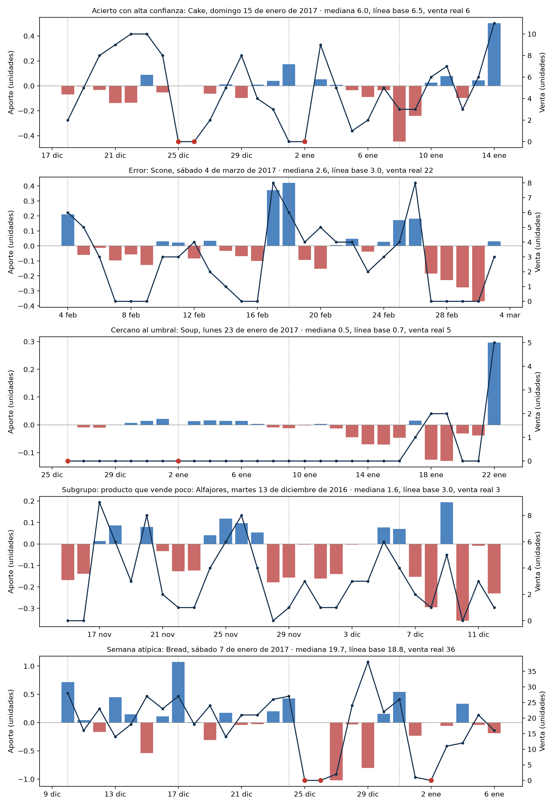
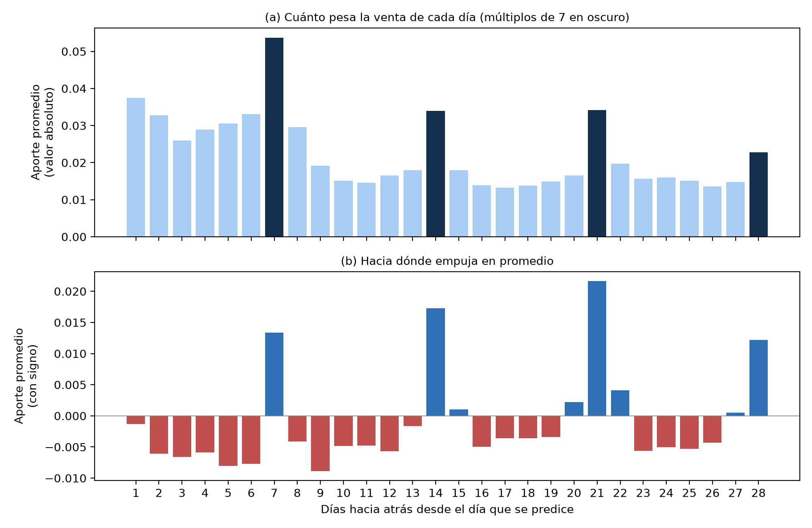

# **1. Investigación: métodos de XAI y herramientas**

Tras leer las instrucciones de esta primera actividad, decidimos investigar a qué se refería cada uno de los requisitos que puede tener un método de explicabilidad, y encontramos lo siguiente. Un método de caja negra es aquel que solo necesita llamar al modelo con una entrada y observar su salida, sin ver sus pesos ni su estructura interna, es decir, trata al modelo como una caja cerrada a la que se le pregunta "¿qué predices si cambio esta parte de la entrada?". En cambio, un método que requiere acceso a gradientes necesita entrar al modelo y calcular cuánto cambia la predicción ante un cambio muy pequeño en cada entrada, lo cual solo es posible si el modelo es diferenciable, es decir, si se puede calcular la derivada de su salida respecto a cada entrada. Esto ocurre cuando el modelo está formado por operaciones que cambian de forma suave, como las sumas, multiplicaciones y funciones de activación de una red neuronal, a diferencia de un árbol de decisión, cuya predicción salta de un valor a otro al cruzar un umbral. Por ejemplo, nuestro LSTM es diferenciable, y de hecho se entrena con esos mismos gradientes. Por otro lado, varios métodos requieren una línea base, que es una entrada de referencia que representa la "ausencia de información", por ejemplo, una ventana, es decir, los 28 días de ventas que el modelo recibe para predecir los 7 siguientes, con todas las ventas en cero o con el promedio de ventas, de tal forma que la explicación mide cuánto se aleja la predicción real de la predicción con esa referencia. Asimismo, el costo computacional lo medimos según cuántas veces hay que llamar al modelo o calcular gradientes para explicar una sola predicción, y las limitaciones se refieren a los casos en que la explicación puede ser engañosa o poco práctica para nuestro problema.

## **1.1 Métodos que aplican a nuestro modelo**

- **Oclusión por ventanas**
  - **Idea:** consiste en tapar un tramo de días de la ventana, por ejemplo una semana, reemplazando sus ventas por un valor de referencia, y observar cuánto cambia la predicción. Si cambia mucho, quiere decir que el modelo dependía de esos días. Luego, el tramo tapado se va moviendo a lo largo de los 28 días para ver cuáles pesan más.
  - **Qué requiere:** es de caja negra, ya que solo necesita llamar al modelo con la ventana tapada, y requiere una línea base, que en este caso es el valor con el que se rellenan los días tapados, como cero o el promedio de la ventana.
  - **Costo computacional:** bajo, ya que solo hace falta una llamada al modelo por cada tramo tapado. Por ejemplo, con tramos de 7 días que se mueven de uno en uno sobre 28 días son 22 llamadas por predicción, y nuestro modelo tarda menos de 1 milisegundo en cada una.
  - **Limitaciones:** el resultado depende del valor de relleno y del tamaño del tramo. Además, al tapar días se crean ventanas que nunca existieron, por ejemplo una semana entera en cero puede parecerle al modelo un cierre del local, lo cual puede exagerar la importancia de ese tramo.

- **IG + TSR (Integrated Gradients con Temporal Saliency Rescaling)**
  - **Idea:** combina dos pasos. Primero, Integrated Gradients (IG) reparte la predicción entre las entradas, es decir, le asigna a cada día y a cada variable un número, llamado atribución, que indica cuánto empujó la predicción hacia arriba o hacia abajo. Luego, TSR corrige un problema que tienen estos métodos en series de tiempo, que suelen mezclar la importancia de un día con la de una variable. Para esto, primero mide qué tan importante es cada día tapándolo completo y viendo cuánto cambian las atribuciones, y después, solo en los días importantes, mide qué variable pesa más dentro de ese día.
  - **Qué requiere:** acceso a gradientes, ya que IG los usa para calcular las atribuciones, y una línea base, que es la entrada de referencia contra la cual IG compara la ventana real, por ejemplo una ventana con todas las ventas en cero.
  - **Costo computacional:** alto, ya que IG por sí solo calcula decenas de gradientes por predicción, y TSR repite ese cálculo una vez por cada día tapado (28 en nuestro caso) y otra vez por cada variable de los días importantes.
  - **Limitaciones:** hereda la dependencia de IG en la línea base y agrega un umbral para decidir qué días son importantes, que también hay que elegir. Además, su ventaja principal es separar la importancia entre muchas variables, y nuestro modelo solo tiene cuatro por día (la venta, si el local abrió, si es feriado y si hay un feriado en los próximos 2 días), por lo que aporta poco frente a usar IG solo.

- **TimeSHAP**
  - **Idea:** adapta SHAP a modelos recurrentes como el LSTM. SHAP viene de la teoría de juegos y reparte la predicción de forma "justa" entre las entradas, como si cada día de la ventana fuera un jugador de un equipo. Para esto, prueba la predicción con distintas combinaciones de días presentes y ausentes, y a cada día le asigna su aporte promedio entre todas esas combinaciones. TimeSHAP lo hace a tres niveles, es decir, qué días pesan, qué variables pesan y qué variable de qué día pesa. Además, para ahorrar cálculos, agrupa los días más viejos en uno solo cuando su aporte es muy pequeño.
  - **Qué requiere:** es de caja negra, ya que solo necesita llamar al modelo, y requiere una línea base, que en este caso es una ventana promedio calculada a partir de un conjunto de ejemplos de fondo, con la cual se rellenan los días "ausentes".
  - **Costo computacional:** alto, ya que por cada predicción hay que llamar al modelo cientos o miles de veces para probar combinaciones de días, aunque la agrupación de los días viejos reduce bastante ese número.
  - **Limitaciones:** el resultado depende del conjunto de fondo y del número de combinaciones probadas, que se eligen al azar, por lo que hay que fijar una semilla para poder repetirlo. Además, al rellenar días con el promedio se crean ventanas que nunca existieron, y nuestro modelo predice 7 días con 9 cuantiles cada uno, por lo que hay que elegir una sola de esas salidas para explicar, por ejemplo la mediana del día siguiente.

- **Dynamask**
  - **Idea:** en lugar de repartir la predicción como IG o SHAP, aprende una máscara, es decir, una tabla con un número entre 0 y 1 para cada día y cada variable de la ventana, que indica qué tanto hay que conservar de esa entrada. Para encontrarla, el método va ajustando la máscara poco a poco hasta lograr dos cosas a la vez, que la predicción con la ventana "borrosa" se parezca lo más posible a la original, y que se conserve la menor cantidad de entradas posible. Las entradas que la máscara decide conservar son las importantes. Además, en lugar de borrar las entradas con ceros, las suaviza con el promedio de los días vecinos, para que la ventana modificada siga pareciéndose a una real.
  - **Qué requiere:** acceso a gradientes, ya que la máscara se ajusta con el mismo procedimiento con el que se entrena una red, y una forma de "borrar" las entradas, que en este caso es el promedio de los días vecinos y no una línea base fija.
  - **Costo computacional:** alto, ya que por cada predicción hay que ajustar una máscara nueva durante cientos de pasos, y en cada paso se llama al modelo y se calculan sus gradientes.
  - **Limitaciones:** depende de varios parámetros que hay que elegir a mano, como qué proporción de entradas se permite conservar y cuánto se castiga que la máscara cambie de un día a otro. Además, sus valores indican qué conservar pero no cuánto aporta cada entrada a la predicción, por lo que, a diferencia de IG o SHAP, no suman la predicción.

- **WinIT (Windowed Feature Importance in Time)**
  - **Idea:** mide la importancia de cada variable en cada día quitándola y observando cuánto cambia la predicción, pero con dos diferencias frente a la oclusión. Primero, toma en cuenta que el efecto de un día puede aparecer con retraso, por ejemplo que la venta de un sábado influya en la predicción de varios días después. Segundo, en lugar de rellenar el valor quitado con ceros o un promedio, lo reemplaza con un valor generado por un segundo modelo, entrenado para imaginar qué valores serían creíbles en ese punto de la serie, de tal forma que la ventana modificada siga pareciendo real.
  - **Qué requiere:** es de caja negra respecto al modelo que se explica, ya que solo necesita llamarlo, pero requiere entrenar aparte ese modelo generativo con los datos de la serie.
  - **Costo computacional:** alto, ya que además de entrenar el modelo generativo una vez, por cada predicción hay que generar valores y llamar al modelo una vez por cada variable de cada día.
  - **Limitaciones:** aplica a nuestro modelo, pero con una limitación práctica, ya que exige construir y entrenar un segundo modelo solo para la explicación, y la calidad de la explicación depende de qué tan bien ese modelo imita los datos reales. Además, está pensado para modelos que hacen una predicción en cada paso de la serie, mientras que el nuestro hace una sola predicción de 7 días por ventana, por lo que habría que adaptarlo.

- **Saliency (gradientes simples)**
  - **Idea:** es el método de gradientes más sencillo. Calcula cuánto cambiaría la predicción si se modificara un poquito cada entrada, y toma ese valor como su importancia. Por ejemplo, si subir apenas la venta del sábado anterior mueve mucho la predicción, ese día se considera importante.
  - **Qué requiere:** acceso a gradientes, pero no necesita línea base, ya que solo mira la ventana real.
  - **Costo computacional:** muy bajo, ya que basta con un solo cálculo de gradientes por predicción, que cuesta más o menos lo mismo que una llamada al modelo.
  - **Limitaciones:** mide qué tan sensible es la predicción a un cambio pequeño, no cuánto aportó realmente cada entrada, por lo que una entrada importante puede salir con importancia casi nula si el modelo ya está "saturado" en ese punto, es decir, si la predicción ya dejó de cambiar aunque la entrada siga subiendo, como cuando una función de activación llega a su valor máximo. Además, suele dar resultados ruidosos, y en un modelo recurrente como el nuestro los gradientes de los días más viejos tienden a hacerse muy pequeños al recorrer toda la ventana, lo que puede hacerlos parecer menos importantes de lo que son.

- **SmoothGrad**
  - **Idea:** busca reducir el ruido de Saliency. Para esto, crea varias copias de la ventana con un poco de ruido aleatorio agregado, calcula los gradientes de cada copia y promedia los resultados, de tal forma que las importancias que aparecen por casualidad en una sola copia se cancelan y quedan las que se repiten en todas.
  - **Qué requiere:** acceso a gradientes, y dos parámetros que hay que elegir, que son cuántas copias crear y cuánto ruido agregarle a cada una.
  - **Costo computacional:** bajo a moderado, ya que es el costo de Saliency multiplicado por el número de copias, que suele estar entre 20 y 50.
  - **Limitaciones:** reduce el ruido pero hereda los demás problemas de Saliency, ya que sigue midiendo sensibilidad y no aporte real. Además, el resultado depende de cuánto ruido se agrega, y en nuestras ventanas el ruido puede producir valores que no existen en la realidad, como ventas negativas o un día "medio abierto".

- **Integrated Gradients (IG)**
  - **Idea:** corrige el problema principal de Saliency, que solo mira un cambio pequeño alrededor de la ventana real. Para esto, recorre un camino en línea recta desde la línea base hasta la ventana real, pasando por varias ventanas intermedias, por ejemplo al 10 %, al 20 % y así hasta el 100 % de cada valor, y en cada una calcula los gradientes. Luego promedia esos gradientes y los multiplica por la diferencia entre la ventana real y la línea base. Así, a cada día y variable le asigna su aporte a la predicción, y la suma de todos los aportes es exactamente la diferencia entre la predicción real y la predicción con la línea base.
  - **Qué requiere:** acceso a gradientes y una línea base, que es el punto de partida del camino, por ejemplo una ventana con todas las ventas en cero.
  - **Costo computacional:** moderado, ya que hay que calcular gradientes en cada ventana intermedia del camino, que suelen ser entre 20 y 300 según la precisión que se busque.
  - **Limitaciones:** el resultado depende mucho de la línea base, ya que los aportes se miden contra ella. Por ejemplo, una ventana en cero no solo significa "sin ventas", sino también "todos los días cerrados", lo cual puede exagerar la importancia de la variable que indica si el local abrió. Además, las ventanas intermedias del camino no siempre son realistas, y con pocos pasos la suma de los aportes deja de cuadrar con la predicción.

- **GradientSHAP**
  - **Idea:** combina IG con la idea de SHAP para no depender de una sola línea base. En lugar de partir siempre de la misma ventana de referencia, toma muchas líneas base distintas de un conjunto de ventanas reales, llamado conjunto de fondo. Para cada una, elige al azar un punto del camino hacia la ventana real, le agrega un poco de ruido y calcula ahí los gradientes. Al promediar todos esos cálculos obtiene una aproximación de los valores SHAP, es decir, del reparto "justo" de la predicción entre las entradas.
  - **Qué requiere:** acceso a gradientes y un conjunto de fondo, que reemplaza a la línea base única de IG.
  - **Costo computacional:** moderado, ya que hay que calcular gradientes una vez por cada muestra, que suelen ser entre 50 y 200 por predicción.
  - **Limitaciones:** como las líneas base y los puntos del camino se eligen al azar, el resultado cambia un poco en cada corrida, por lo que hay que fijar una semilla. Además, depende de qué ventanas se elijan como conjunto de fondo, y solo es una aproximación de SHAP, que se vuelve exacta únicamente si las entradas son independientes entre sí, algo que no ocurre en una serie de tiempo, donde la venta de un día se parece a la de los días cercanos.

- **LIME (Local Interpretable Model-agnostic Explanations)**
  - **Idea:** explica una predicción construyendo, solo alrededor de ella, un modelo sencillo que se pueda leer, como una regresión lineal. Para esto, crea cientos de versiones de la ventana en las que "apaga" al azar algunos tramos de días, por ejemplo reemplazando una semana por su promedio, le pide al modelo una predicción para cada versión y ajusta la regresión con esos resultados, dándole más peso a las versiones que se parecen más a la ventana real. Los coeficientes de esa regresión indican cuánto aporta cada tramo de días.
  - **Qué requiere:** es de caja negra, ya que solo necesita llamar al modelo, y requiere elegir cómo se dividen los días en tramos, con qué se rellenan los tramos apagados y qué tan rápido baja el peso de una versión a medida que se aleja de la ventana real.
  - **Costo computacional:** moderado, ya que hay que llamar al modelo cientos o miles de veces por predicción, aunque ajustar la regresión al final es casi inmediato.
  - **Limitaciones:** como las versiones se crean al azar, dos corridas pueden dar explicaciones distintas, por lo que hay que fijar una semilla. Además, el resultado depende de cómo se dividan los tramos y de cuánto peso se le dé a cada versión, y la regresión solo es una aproximación, que puede ser mala si el modelo se comporta de forma muy distinta a una línea recta alrededor de esa predicción.

## **1.2 Métodos que no aplican a nuestro modelo**

- **Atención (TFT):** lee los pesos de atención de un Temporal Fusion Transformer para ver a qué días les prestó atención el modelo, pero nuestro LSTM no tiene una capa de atención, por lo que no hay pesos que leer.
- **Grad-CAM:** combina los gradientes con las salidas de una capa convolucional para resaltar las zonas importantes de una imagen, pero nuestro modelo no tiene capas convolucionales.
- **TreeSHAP:** calcula los valores SHAP de forma exacta y rápida aprovechando la estructura de un árbol de decisión, por lo que solo funciona con modelos de árboles y no con una red neuronal.

## **1.3 Preguntas de la investigación**

- **¿Qué diferencia hay entre un modelo interpretable por diseño y una explicación a posteriori? ¿Nuestro proyecto tendría un baseline interpretable contra el cual comparar?**

Un modelo interpretable por diseño es aquel cuya forma de decidir se puede leer directamente, sin herramientas extra, como una regresión lineal, donde cada coeficiente dice cuánto pesa cada entrada, o un árbol pequeño, donde se puede seguir cada regla hasta la predicción. En cambio, una explicación a posteriori se calcula después de entrenar un modelo que no se puede leer por dentro, como nuestro LSTM, cuyas decisiones están repartidas entre miles de pesos, por lo que métodos como IG intentan reconstruir en qué se basó cada predicción. En nuestro caso sí contamos con un baseline interpretable, ya que las dos líneas base del proyecto final son reglas que cualquiera puede seguir, como producir lo mismo que el mismo día de la semana pasada, o el promedio de los mismos días en las últimas cuatro semanas. La segunda fue la mejor, con un WAPE, que es el error total del modelo como porcentaje de lo que realmente se vendió, de 42.3 % en The Bread Basket, frente a 41.3 % del modelo final, que además ahorra unas £59 al mes frente a ella. Es decir, el LSTM mejora a la regla, aunque no por mucho, lo cual es justo el tipo de comparación que permite decidir si vale la pena usar un modelo que necesita explicaciones a posteriori.

- **¿Qué propiedades formales tiene el método elegido y qué garantiza cada una?**

IG cumple tres propiedades principales, que fueron justamente las que sus autores buscaban al proponerlo. La primera es la completitud, que garantiza que la suma de los aportes de todos los días y variables es exactamente la diferencia entre la predicción real y la predicción con la línea base, es decir, ningún pedazo de la predicción queda sin explicar ni se cuenta dos veces. Por ejemplo, si el modelo predice 30 panes y con la línea base predice 10, los aportes de los 28 días suman 20. La segunda es la sensibilidad, que garantiza que si una entrada es distinta a la de la línea base y eso cambia la predicción, esa entrada recibe un aporte distinto de cero, por lo que el método no puede ignorar algo que sí influyó, que es justamente el problema que tiene Saliency cuando el modelo está saturado. La tercera es la invariancia a la implementación, que garantiza que dos redes que dan siempre las mismas predicciones reciben las mismas explicaciones, aunque por dentro estén construidas de forma distinta, por lo que la explicación depende de lo que el modelo hace y no de cómo está programado.

- **¿Qué parámetros de diseño afectan la explicación?**

En el caso de IG, el parámetro que más afecta la explicación es la línea base, ya que todos los aportes se miden contra ella, por lo que una línea base distinta responde una pregunta distinta. Por ejemplo, una ventana con todas las ventas en cero pregunta "¿cuánto aporta cada día frente a no haber vendido nada?", mientras que una ventana con el promedio pregunta "¿cuánto aporta cada día frente a una semana normal?". Luego, está el número de pasos del camino entre la línea base y la ventana real, ya que con más pasos el cálculo es más preciso pero también más costoso. Además, hay que elegir qué salida del modelo se explica, ya que el nuestro predice 7 días con 9 cuantiles cada uno, y no es lo mismo explicar la mediana del día siguiente que la cantidad recomendada para dentro de una semana. Por último, también afecta cómo se resumen los aportes para la explicación global, por ejemplo si se promedian con su signo, donde un día que empuja hacia arriba en una predicción y hacia abajo en otra se cancela, o en valor absoluto, que mide cuánto pesa cada día sin importar la dirección. En los demás métodos de la investigación aparecen parámetros parecidos, como el conjunto de fondo en SHAP, el tamaño de los tramos y el peso de cada versión en LIME, o el valor de relleno en la oclusión.

# **2. Selección del método**

A partir de la investigación anterior, elegimos Integrated Gradients (IG) como método principal y descartamos TimeSHAP, que consideramos su alternativa más fuerte, ya que es el único método de la lista diseñado específicamente para modelos recurrentes como el nuestro. La comparación entre ambos se resume en la siguiente tabla.

| Criterio | Integrated Gradients (elegido) | TimeSHAP (descartado) |
| :- | :- | :- |
| Compatibilidad con el modelo y el tipo de dato | Se aplica directo sobre el LSTM ya entrenado, ya que es diferenciable, y la librería Captum que lo implementa trabaja con PyTorch | También es compatible con el LSTM, pero su librería no funciona con las versiones de numpy y shap que usa nuestro proyecto, por lo que habría que reproducir su idea con otra herramienta |
| Tipo de explicación | El aporte de cada día y de cada variable a la predicción, que suman exactamente la diferencia con la línea base | El aporte de cada día y de cada variable, aproximado con muestras al azar |
| Costo frente a la latencia y el volumen | Moderado, con 50 cálculos de gradientes por predicción, menos de 1 milisegundo en nuestras pruebas, por lo que se podría explicar cada recomendación a pedido | Alto, con cientos o miles de llamadas al modelo por predicción, por lo que solo es viable para auditorías y no para cada recomendación |
| Facilidad de comunicación | Se puede mostrar como barras por día, por ejemplo indicando que "el sábado pasado empujó tu recomendación hacia arriba" | Igual de fácil de mostrar, ya que también da aportes por día |
| Limitaciones para nuestro caso | Depende de la línea base, que hay que elegir y justificar con cuidado | Depende del conjunto de fondo y del número de muestras, y cambia entre corridas si no se fija una semilla |

Dicho esto, la diferencia que más pesó en la decisión fue el costo computacional, y la limitación principal de IG, su dependencia de la línea base, la abordamos en la implementación eligiéndola y justificándola con cuidado.

# **3. Implementación**

## **3.1 Parámetros de diseño**

Aplicamos IG con la librería Captum sobre el modelo final, sin volver a entrenarlo, y comprobamos que reproduce el WAPE de 41.33 % del proyecto final, es decir, que explicamos exactamente el mismo modelo.

- **Salida explicada:** el modelo predice 9 cuantiles por día, es decir, cantidades que alcanzan para cubrir desde la mitad hasta 9 de cada 10 días, a lo que llamamos su escalera de cuantiles. Explicamos el primero de ellos, la mediana del día siguiente, que es la venta de un día típico, ya que es la predicción más directa del modelo y la que se compara con la venta real.
- **Línea base:** una semana "plana", con la venta promedio en cada día abierto, 0 en los cerrados y el mismo calendario de la ventana real. La preferimos a una ventana en ceros, que representa un local cerrado 28 días y exagera el peso de la variable "abierto". La desventaja es que el calendario no recibe aporte, ya que es igual en ambas.
- **Número de pasos:** 50, el valor por defecto de Captum, ya que con ellos la suma de los aportes difiere de la predicción en menos de 0.03 unidades.
- **Datos:** la prueba de The Bread Basket, un negocio que el modelo nunca vio.
- **Semilla:** 123, la misma del proyecto final, que solo interviene al elegir al azar la instancia del subgrupo.

## **3.2 Explicaciones locales**

Elegimos 5 ventanas de prueba con una regla fija cada una, para no escoger a mano los casos que más convienen.

- **Acierto con alta confianza:** entre el 10 % de ventanas con la escalera de cuantiles más angosta, la de menor error. Fue el cake del domingo 15 de enero de 2017, con una mediana de 6.0 y una venta real de 6.
- **Error:** la de mayor error respecto a su nivel de ventas. Fue el scone del sábado 4 de marzo, con una mediana de 2.6 y una venta real de 22.
- **Cercano al umbral:** la mediana con la parte decimal más cerca de .5, donde un cambio mínimo cambia el entero al redondear. Fue la sopa del lunes 23 de enero, con una mediana de 0.5 y una venta real de 5.
- **Subgrupo de interés:** al azar entre los productos que venden menos de 2 unidades al día, uno de los grupos donde el modelo funciona peor. Fueron los alfajores del martes 13 de diciembre, con una mediana de 1.6 y una venta real de 3.
- **Semana atípica:** el pan del sábado 7 de enero, cuya ventana incluye Navidad y Año Nuevo. Tuvo una mediana de 19.7 y una venta real de 36.

En la Figura 1, las barras azules son los días que empujaron la predicción hacia arriba frente a la semana plana y las rojas los que la empujaron hacia abajo. En el acierto y en la sopa, el aporte más grande es el del día anterior, mientras que en el pan pesan más los sábados anteriores y en el error los 4 días previos con venta 0.

**Figura 1.** Aporte de la venta de cada día de la ventana a la mediana del día siguiente (barras) y venta de ese día (línea), para las 5 instancias.

## **3.3 Explicación global**

Para la visión agregada calculamos IG sobre todas las ventanas de prueba de The Bread Basket cuyo día siguiente el local abrió, 2,408 en total, y promediamos el aporte de cada día de dos formas (Figura 2). Los aportes se dividen entre el nivel de ventas de cada ventana, para que un producto que vende 30 unidades no pese más que uno que vende 3.

- **Cuánto pesa cada día (valor absoluto):** el que más pesa es el de hace 7 días, seguido del día anterior y de los de hace 14 y 21 días. Entre esos, los días pesan poco, salvo la última semana, que pesa más que la historia vieja.
- **Hacia dónde empuja (con signo):** los días que caen en el mismo día de la semana que el que se predice empujan en promedio hacia arriba, y casi todos los demás hacia abajo. Es decir, frente a una semana plana, el modelo acerca la predicción al nivel de ese mismo día de la semana.

**Figura 2.** Aporte promedio de la venta de cada día según los días hacia atrás, (a) en valor absoluto y (b) con su signo.

## **3.4 Reproducibilidad**

Todas las figuras y tablas de esta actividad se regeneran corriendo de principio a fin el notebook `forecasting/explainableAi/explicabilidad.ipynb`, con el mismo entorno del proyecto final más Captum 0.9.0. A diferencia de SHAP o LIME, IG no usa muestras al azar, por lo que con la misma línea base y el mismo número de pasos siempre da los mismos aportes, y la única parte aleatoria, la elección de la instancia del subgrupo, usa la semilla 123. Además, el notebook comprueba al inicio que el modelo reproduce el WAPE del proyecto final y se detiene si no lo hace. Los pasos para ejecutarlo están en el README del repositorio.

# **4. Interpretación en el contexto del proyecto**

- **¿El modelo se basa en señales que tienen sentido para el dominio? ¿Hay evidencia de atajos, fugas de información o variables proxy?**

Sí, el modelo se basa en lo que un panadero usaría para decidir, es decir, las ventas de los mismos días de semanas anteriores y las de los últimos días. Para buscar fugas, revisamos que ninguna entrada traiga datos del día predicho. La única sospechosa era si el local abre en los días futuros, que en la prueba se deduce de las ventas reales, pero en el proyecto final medimos que desordenarla cambia el WAPE en menos de 0.1 puntos, por lo que el modelo no la aprovecha. Tampoco hay variables proxy, ya que el modelo no recibe el nombre del producto ni del negocio, y cada ventana se divide entre su propio nivel de ventas. Por último, el posible atajo sería copiar la semana pasada, pero el modelo combina cuatro semanas con los últimos días y le gana a esa regla en The Bread Basket (41.3 % contra 47.9 % de WAPE).

- **¿Qué entradas llevaron al modelo a equivocarse? ¿Qué lo habría corregido?**

En los casos con más error, el modelo se equivocó por leer como falta de demanda algo que en realidad era otra cosa. En el scone, los 4 días previos sin ventas, con el local abierto, fueron los que más bajaron la predicción, y luego se vendieron 22, lo que sugiere que el producto no estuvo disponible esos días y no que nadie lo quisiera. En la sopa pasó algo parecido, ya que después de casi un mes en 0 reapareció en el menú y el modelo reaccionó tarde. En el pan del 7 de enero, los días cerrados y las ventas bajas después de las fiestas pesaron demasiado, y predijo 19.7 cuando se vendieron 36. En los tres casos, lo que lo habría corregido es un dato que hoy no tiene, como registrar si un producto estaba agotado o fuera del menú, o tener al menos un año de historia para reconocer la temporada de fiestas.

- **¿Qué decisiones concretas cambian gracias a la explicación?**

La explicación nos llevó a tres decisiones. Primero, recolectar un dato nuevo, ya que los errores más grandes vinieron de días sin ventas que el modelo interpretó como falta de demanda, por lo que en Restocker convendría que el usuario pueda marcar un producto como agotado o fuera del menú, igual que hoy marca un día como cerrado. Segundo, agregar una regla de revisión humana, de tal forma que si un producto que suele venderse lleva varios días en 0, la aplicación pregunte si estuvo agotado antes de generar el pronóstico, en lugar de confiar en la recomendación. Tercero, no usar el modelo sin revisión en las semanas posteriores a feriados largos, como Navidad y Año Nuevo, mientras el negocio no tenga al menos un año de historia. En cambio, no eliminamos ninguna variable, ya que el modelo se apoya en las ventas como esperábamos y las variables del calendario son baratas de mantener.

- **¿Cómo se mostraría la explicación a la audiencia objetivo?**

La audiencia es quien decide la producción del día, por lo que la explicación no debería mostrar gráficas de atribución ni términos técnicos, sino una oración con los días que más pesaron. Por ejemplo, al abrir el detalle de un producto en la pantalla de Pronóstico, la aplicación diría algo como "Recomendamos más de lo normal porque el sábado pasado vendiste 36 y los últimos sábados también vendieron más que el resto de la semana". Para armarla, se tomarían los dos o tres días con el aporte más grande y su dirección, y como en nuestras pruebas IG tardó menos de 1 milisegundo por predicción, se podría calcular cada vez que el usuario abre el detalle. Esto hoy no está implementado, pero encaja con lo que ya muestra la aplicación, que explica de dónde viene la recomendación con el precio y el costo del producto.

- **Si el sistema es de alto riesgo y un modelo interpretable alcanza un rendimiento similar, ¿convendría usarlo en su lugar?**

En un sistema de alto riesgo sí convendría, ya que si dos modelos rinden parecido, el que se puede leer directamente permite revisar cada decisión sin depender de una explicación aproximada. Sin embargo, consideramos que nuestro sistema es de bajo riesgo, ya que un error cuesta unas pocas unidades de un producto, el usuario revisa la recomendación antes de producir y puede corregirla con su criterio. Además, el rendimiento no es del todo similar, ya que frente a la mejor regla interpretable, el promedio de los mismos días de las últimas cuatro semanas, el modelo final baja el WAPE de 42.3 % a 41.3 % y ahorra unas £59 al mes, y sobre todo recomienda producir según el precio y el costo de cada producto, algo que la regla no hace. Dicho esto, la regla sí podría servir como respaldo, por ejemplo para los productos que todavía no tienen 28 días de historia.
